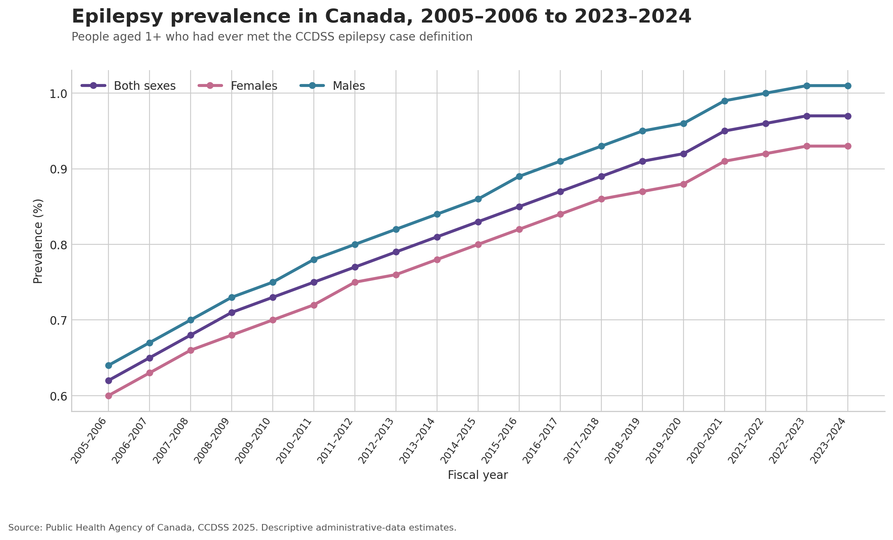
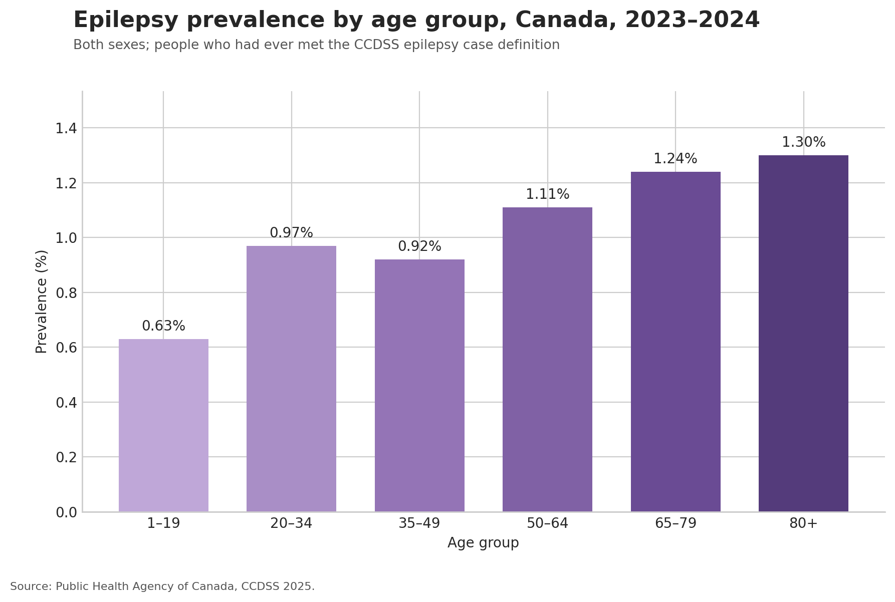

# Epilepsy Prevalence in Canada: R Analysis and Equity Data Audit

[](https://github.com/niknaz-akbarpour/epilepsy-prevalence-canada-equity/actions/workflows/r-validation.yml)

This reproducible portfolio project examines Canadian epilepsy prevalence using official surveillance data and documents what can—and cannot—currently be concluded about differences among racialized, Indigenous and immigrant population groups.

## Research questions

1. How has diagnosed epilepsy prevalence changed in Canada over time?
2. How does prevalence differ by age, sex and province or territory?
3. Are nationally comparable prevalence estimates available by racial or ethnic population group?

## Principal findings from the latest official data

For fiscal year **2023–2024**, the Canadian Chronic Disease Surveillance System reported:

- **314,460** people aged 1 year and older who had ever met the epilepsy case definition;
- crude prevalence of **0.97%**;
- **214,105** people meeting the active-epilepsy definition;
- active prevalence of **0.66%**.

These are administrative health-data estimates, not direct clinical diagnoses made for this project.

## Results at a glance





## Equity and race/ethnicity limitation

The national CCDSS epilepsy download is stratified by age, sex and geography, but **does not include race, ethnicity, Indigenous identity or immigration status**. Consequently, this repository does not produce a race-specific national prevalence chart.

Instead, `data/evidence/population_disparities_evidence.csv` records the limited subgroup evidence separately. The strongest numeric Canadian comparison located was a Saskatchewan study reporting an age-standardized **incidence** of 122 per 100,000 person-years among people recorded under the study's historical self-identification category, with an incidence rate ratio of 1.6. It must not be described as national prevalence.

This separation prevents inappropriate comparison of different measures, populations and time periods.

## Data source

- **Publisher:** Public Health Agency of Canada
- **System:** Canadian Chronic Disease Surveillance System (CCDSS), 2025 edition
- **Latest fiscal year:** 2023–2024
- **Official tool:** https://health-infobase.canada.ca/ccdss/data-tool/
- **Methods:** https://health-infobase.canada.ca/ccdss/Methods

CCDSS applies validated case definitions to linked provincial and territorial administrative health records. Estimates may be suppressed for small or statistically unstable cells, and pandemic-period values require cautious interpretation.

## Repository structure

```text
epilepsy-prevalence-canada-equity/
├── data/
│   ├── raw/                    # Original PHAC downloads
│   ├── processed/              # Analysis-ready CSV files
│   └── evidence/               # Carefully labelled subgroup evidence
├── outputs/
│   ├── figures/                # Portfolio-ready visualizations
│   └── *.csv                   # Reproducible summary tables
├── scripts/
│   ├── 01_download_prepare.R
│   └── 02_analysis_visualization.R
├── DATA_DICTIONARY.md
├── LIMITATIONS.md
├── PROJECT_STATUS.md
└── README.md
```

## Reproduce the analysis

From the repository root, run:

```bash
Rscript scripts/01_download_prepare.R
Rscript scripts/02_analysis_visualization.R
```

The scripts use only base R. They download the official tables, remove source footnotes from the analysis rows, standardize fields, create summary tables and generate two figures.

## Appropriate CV description

> **Epilepsy Prevalence in Canada — Reproducible R Portfolio Project**  
> Developed a reproducible workflow using Public Health Agency of Canada surveillance data to examine epilepsy prevalence by time, age, sex and geography; audited the availability and limitations of race- and ethnicity-stratified Canadian data.

## Repository topics

`r` · `epilepsy` · `public-health` · `epidemiology` · `health-equity` · `canada` · `reproducible-research`

## Responsible interpretation

This is a descriptive data portfolio project and not a peer-reviewed epidemiological study. It does not establish causality, individual risk or clinical guidance. Race and ethnicity should not be treated as biological explanations; observed disparities can reflect social, environmental, structural and health-system factors.

